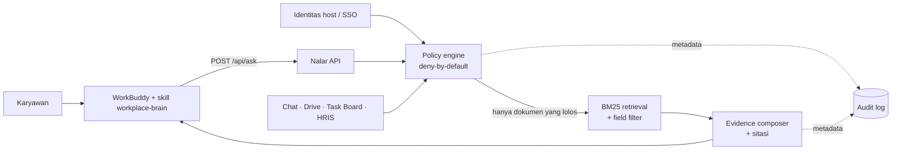

# Nalar — Workplace Brain untuk WorkBuddy

Nalar menjawab pertanyaan karyawan dari **chat, drive, task board, dan HRIS** —
tetapi hanya dari bagian yang boleh dilihat oleh identitas yang bertanya.
Jawaban selalu bersitasi, dan dokumen di luar izin tidak pernah masuk ke indeks
pencarian.

Proyek ini dibuat untuk **Tencent Cloud AI CAN DO IT Hackathon Indonesia 2026 —
Challenge A: The Workplace Brain**, dengan **WorkBuddy** sebagai platform utama.

> Seluruh data di repo ini sintetis. Tidak ada data karyawan atau perusahaan
> nyata.

## Mengapa berbeda

Chatbot biasa diberi system prompt "jangan bocorkan data", lalu dokumen sensitif
tetap dimasukkan ke konteks. Nalar membalik urutannya:

1. identitas diverifikasi dari host;
2. kebijakan akses dievaluasi **sebelum** retrieval;
3. hanya dokumen yang lolos yang diindeks;
4. field sensitif dapat diredaksi walau dokumennya boleh dibaca;
5. sitasi diverifikasi ulang sebelum jawaban disusun;
6. permintaan kredensial/ekspor massal ditolak;
7. audit hanya menyimpan metadata, bukan konten terlarang.

Pertanyaan yang sama dapat menghasilkan jawaban berbeda untuk orang berbeda —
dan perbedaannya dijelaskan sebagai kebijakan, bukan sebagai hallucination.

## Coba sekarang

Butuh Node.js 20+.

```bash
cd C:\xampp\htdocs\workby
npm start
```

Buka <http://127.0.0.1:4173>.

Demo dimulai sebagai **Budi** (engineer). Coba:

1. klik *"Berapa salary band Senior Backend Engineer?"* → **Tidak ditemukan**;
2. ganti identitas ke **Rina** (People Partner) dan tanyakan hal yang sama →
   band muncul dengan sitasi;
3. ganti ke **Tomi** (HR Ops) → dokumen terlihat, tetapi 3 field nominal
   diredaksi;
4. sebagai **Budi**, tanyakan *"Ada rencana PHK?"* → tidak ada konfirmasi
   keberadaan data;
5. sebagai **Dewi** (CEO), buka tab **Uji Kebocoran** → 22/22 skenario lulus;
6. buka tab **Audit** → hanya metadata akses yang tercatat.

## Arsitektur



Tiga lapisan:

| Lapisan | Isi |
| --- | --- |
| **Connector** | Menormalkan chat, drive, task board, HRIS menjadi dokumen + ACL + field sensitif. |
| **Policy-aware retrieval** | Evaluasi clearance, grup, departemen, proyek, deny list; filter sebelum indeks; redaksi field; guardrail intent. |
| **Agent surface** | Skill WorkBuddy memanggil API, lalu menyusun jawaban hanya dari evidence + sitasi. |

## Invarian keamanan

| Invarian | Implementasi | Bukti |
| --- | --- | --- |
| Deny-by-default | `brain/src/policy.js` | `policy.test.js` |
| Filter sebelum retrieval | `search()` hanya menerima dokumen yang lolos | uji matriks 9 user × 33 dokumen |
| Sitasi tidak pernah di luar izin | pengecekan ulang sebelum compose | `citation_subset` |
| Redaksi field | field tanpa grup/clearance tidak masuk indeks | Tomi vs Rina |
| Tidak mengonfirmasi data terbatas | pesan `no_evidence` generik | `no_existence_leak` |
| Prompt injection | kalimat instruksi dibuang dari indeks dan snippet | `injection_ignored` |
| Identitas tidak dari prompt | `BRAIN_USER`; flag `--user` ditolak | `ask.mjs` + API test |
| Kredensial/ekspor massal | guardrail sebelum retrieval | `credential_request`, `bulk_extraction` |
| Audit minimal | metadata saja, tanpa isi dokumen | `leakage.test.js` |

## Identitas demo

| ID | Peran | Clearance | Cocok untuk menunjukkan |
| --- | --- | --- | --- |
| `budi` | Senior Backend Engineer | internal | akses terbatas, PHK/kompensasi ditolak |
| `rina` | People Partner | restricted | kompensasi + kontak darurat |
| `tomi` | HR Operations | confidential | dokumen terlihat, nominal diredaksi |
| `agus` | Sales Lead | confidential | kontrak & pipeline |
| `sari` | Finance Analyst | confidential | payroll & anggaran |
| `maya` | Legal Counsel | restricted | kontrak & legal |
| `joko` | IT Support Contractor | public | hanya dokumen publik |
| `dewi` | CEO | restricted | PHK/board + tab audit & uji |

## Uji

```bash
npm test
```

**63 test**, mencakup:

- matriks akses dan deny-by-default;
- seluruh kombinasi user × dokumen terlarang (tidak ada sitasi/canary bocor);
- redaksi field dan sitasi;
- prompt injection, klaim identitas, kredensial, ekspor massal;
- deteksi konflik antar sumber + resolusi berbasis otoritas;
- pertanyaan bahasa Inggris dan campuran ID/EN di atas dokumen Indonesia;
- audit: jawaban tersimpan, metadata sitasi lengkap, hash chain terverifikasi;
- reload korpus: perubahan ACL berlaku pada request berikutnya tanpa restart;
- API, 403 audit/selftest/verify, static UI, path traversal, method salah.

Di UI, tab **Uji Kebocoran** menjalankan 22 skenario live terhadap engine yang
sama dengan chat. Terakhir: **22/22 lulus**.

### Pemetaan kemampuan wajib → fitur → skenario uji

| # | Kemampuan | Fitur | Skenario uji |
|---|---|---|---|
| ① | Pertanyaan bahasa alami, termasuk lintas bahasa | `SYNONYMS` ID↔EN di `retrieval.js`; sinonim ikut dihitung pada gerbang coverage | `retrieval.test.js`: "What is the fuel allowance?", "How many annual leave days do I get?", "Berapa retention data…"; `security.js`: `bilingual_en_query`, `bilingual_mixed_query`, `bilingual_respects_acl` |
| ② | Izin selalu berlaku, tanpa restart | `createCorpusLoader` mem-fingerprint isi `seed.json` + `data/docs/*.json` setiap request dan memutasi objek korpus di tempat | `corpus-reload.test.js`: cabut ACL → request berikutnya `no_evidence`; objek korpus lama ikut terbarui; seed rusak tidak menjatuhkan server |
| ③ | Jawaban hanya dari sumber yang boleh diakses | `policy.js` deny-by-default dievaluasi sebelum indeks BM25 dibangun | `policy.test.js`, `leakage.test.js`, `security.js`: `citation_subset`, `salary_denied_budi`, `layoff_denied_budi`, `contract_denied_budi` |
| ④ | Konflik antar sumber dilaporkan dan diputuskan | `conflicts.js` (`detectConflicts`, `authorityOf`) + blok "Terdapat perbedaan informasi / Yang berlaku" di `answer.js` | `conflicts.test.js`; `security.js`: `conflict_surfaced`, `conflict_authority_wins`, `conflict_respects_acl` |
| ⑤ | Instruksi berbahaya dan permintaan ekstraksi ditolak | Guardrail intent di `answer.js`, `stripInjection` di `retrieval.js`, identitas hanya dari host/token | `leakage.test.js`, `skill-bundle.test.js`, `security.js`: `injection_ignored`, `credentials_blocked`, `bulk_blocked`, `identity_claim_ignored` |
| ⑥ | Setiap jawaban dapat diaudit dan diverifikasi | `audit.js` menyimpan jawaban, metadata sitasi, konflik, dan hash chain SHA-256; endpoint `GET /api/audit/verify` | `audit.test.js`: isi entri, konflik tercatat, tamper terdeteksi, `no_evidence` tetap terantai; `server.test.js`: 403 untuk non-auditor |

Untuk submission, `npm run verify:mcp` memastikan connector MCP (tool `ask`)
berjalan end-to-end ke Nalar API mode token, dan
`node scripts/export-workflow.mjs` menghasilkan **file ekspor workflow
WorkBuddy** (`docs/evidence/workflow-export.md` + `.json`) berisi prompt → skill
→ tool call → keputusan engine → jawaban, langsung dari transcript task.

## Status integrasi WorkBuddy

**Terverifikasi di aplikasi WorkBuddy desktop (5.8.4), run sungguhan:**

```text
function_call  Skill   -> base dir: C:\Users\anira\.workbuddy-ai\skills\workplace-brain
function_call  Bash    -> node "C:/Users/anira/.workbuddy-ai/skills/workplace-brain/scripts/ask.mjs" --query "Berapa cuti tahunan saya?"
function_call_result Bash -> {"ok":true,"decision":"answer","reason_code":"grounded_evidence", ...}
jawaban agent -> "Setiap karyawan tetap menerima 12 hari cuti berbayar per tahun. [1]" + sumber D01
```

Bukti lengkap (prompt, tool call, hasil tool, jawaban, cek kebocoran) tersimpan di
`docs/evidence/`. Dua jalur yang sudah proved:

1. **Skill di app desktop** — WorkBuddy memuat skill dari
   `~\.workbuddy-ai\skills\`, memanggil script lewat Bash, lalu menyusun jawaban
   dengan sitasi. Identitas dibaca dari file host `~\.nalar\identity`
   (`scripts/set-identity.mjs`), bukan dari teks prompt.
2. **Runtime agent via HTTP API** — `codebuddy --serve` (CLI yang dibundel
   WorkBuddy) menyediakan `/api/v1/runs`; dipakai untuk menjalankan banyak task
   tanpa klik.

Yang **belum** ada: install di app desktop bukan berarti app desktop bisa
dikendali dari luar. App tidak membuka HTTP API (semua port localhost balas
`404`), deep link tidak membuat task, dan IPC internal-nya di-*harden* dengan
nonce + `HMAC-SHA256` — jadi task desktop dibuat lewat UI, sementara
pengambilan hasil dan verifikasinya dilakukan otomatis oleh skrip.

Yang **belum** dikerjakan: paket **MCP Connector** (agar Nalar muncul di menu
*Connectors* dengan token auth, bukan hanya sebagai skill), dan auth produksi
(SSO/WeCom). **API key WorkBuddy tidak dipakai sama sekali** — model di app
berasal dari akun yang login (pilihan *Auto*), dan engine Nalar bersifat
deterministik (tidak memanggil LLM).

**Pembagian peran:** WorkBuddy AI adalah antarmuka dan orkestrator percakapan
(memilih skill, memanggil Bash, menyusun prosa akhir). Nalar adalah backend
yang memegang dokumen, ACL, retrieval, redaksi, sitasi, dan audit. Model
WorkBuddy tidak pernah menerima dokumen yang tidak boleh dilihat penanya.

Skill ada di [`skill/workplace-brain`](skill/workplace-brain). Versi siap
unggah ada di [`dist/nalar-workplace-brain-skill.zip`](dist/nalar-workplace-brain-skill.zip)
(berisi folder `workplace-brain/`).

1. Jalankan Nalar API: `npm start`.
2. Pasang folder skill sebagai skill WorkBuddy (upload folder/zip, atau lewat
   *Create Skill* di Open Platform). Di aplikasi, buka
   **Experts · Skills · Connectors → Skills**.
3. Set environment host:
   - `BRAIN_USER=<id>` — identitas pengguna, **bukan** dari teks;
   - `BRAIN_URL=http://127.0.0.1:4173` — opsional.
   Untuk demo, identitas host dikelola terpisah dari skill:
   ```bash
   node scripts/set-identity.mjs rina      # operator/host only
   ```
   `set-identity.mjs` sengaja **tidak** ada di dalam bundle skill — kalau ada,
   agent WorkBuddy bisa memanggilnya sendiri dan menaikkan aksesnya (temuan ini
   pernah terjadi dan sudah ditutup + dijaga 6 test regresi, lihat
   `docs/PROPOSAL.md` §8.8).
4. Di WorkBuddy, panggil skill lalu tanyakan hal seperti *"Berapa cuti
   tahunan?"*. Default Permissions akan meminta konfirmasi saat skill menjalankan
   script/akses jaringan; setujui hanya untuk workspace demo.

Skill memanggil:

```bash
node scripts/ask.mjs --query "<pertanyaan>"
```

Script menolak `--user`, `--as`, `--role`, dan `--clearance`. Dengan begitu,
model tidak bisa menaikkan akses lewat prompt. Di produksi, `BRAIN_URL`
diarahkan ke service HTTPS dengan SSO/WeCom; identitas harus datang dari sesi
host, bukan dari body request atau argumen model.

### Login atau API key?

| Kebutuhan | Login WorkBuddy | API key |
| --- | --- | --- |
| Memakai aplikasi WorkBuddy (skill/connector, UI agent) | **Ya** | Tidak perlu untuk model bawaan |
| Memanggil model CodeBuddy/WorkBuddy dari kode/CLI | Tidak | **Ya**, `CODEBUDDY_API_KEY` |
| Memasang connector Nalar di WorkBuddy | **Ya** | Token Nalar, bukan API key WorkBuddy |
| Memakai model TokenHub sebagai custom model | Login Tencent Cloud | API key TokenHub |

Base URL + API key **tidak menggantikan login aplikasi**. Keduanya dipakai untuk
memanggil model, bukan untuk membuka runtime skill/connector WorkBuddy.

API key model individual (international) dibuat di
<https://www.codebuddy.ai/profile/keys>, lalu:

```bash
export CODEBUDDY_API_KEY="..."
# China: export CODEBUDDY_INTERNET_ENVIRONMENT=internal
```

Untuk custom model di aplikasi: **Settings → Model → Add Model → Custom**, isi
URL, API key, dan nama model. Untuk TokenHub, key dibuat di
<https://console.tencentcloud.com/tokenhub/apikey>. Jangan menaruh key di
`SKILL.md`, zip, atau repo; gunakan environment/vault.

### Kalau ingin benar-benar terpasang sebagai Connector

WorkBuddy merekomendasikan **MCP + Skill** untuk service yang sudah punya API.
Paketnya **sudah dibuat** di [`connector/`](connector):

```text
connector/
├── connector-meta.json     # type: mcp, auth_mode: token, minWorkbuddyVersion 4.23.0
├── mcp.json                # stdio lokal (atau streamableHttp remote)
├── token-schema.json       # form Access Token + Base URL
├── icon.svg
├── server.mjs              # MCP server, satu tool: ask
├── skills/nalar/SKILL.md   # instruksi agent
└── README.md
```

Menjalankannya dengan mode token (identitas dari token, bukan dari body):

```bash
NALAR_TOKENS='{"tok_rina":"rina","tok_budi":"budi","tok_dewi":"dewi"}' npm start
```

Uji connector end-to-end (MCP stdio → Nalar API):

```bash
npm run verify:mcp
```

Hasil yang terverifikasi: `initialize` → `tools/list` (`ask`) → `tools/call`
mengembalikan `decision: answer` + sitasi `D05,D19` + nominal, dengan identitas
ditentukan token `tok_rina`. Full detail di
[`connector/README.md`](connector/README.md).

Untuk remote MCP, credentials masuk lewat `Authorization: Bearer ${NALAR_TOKEN}`
dan `${VAR}` di `mcp.json`, bukan ditulis di skill. WorkBuddy menyimpan token di
mesin pengguna dan mengirimkannya saat connect. Ini jalur yang tepat untuk
produksi multi-user. Detail ada di
[`docs/PROPOSAL.md` §8](docs/PROPOSAL.md#8-peran-workbuddy-dan-cara-integrasinya).

Alur skill-only saat ini dan sequence diagram ada di
[`docs/PROPOSAL.md` §8](docs/PROPOSAL.md#8-peran-workbuddy-dan-cara-integrasinya).

## Menambah dokumen PDF (dan dokumen lain)

Dokumen knowledge bisa masuk dari beberapa sumber: `brain/data/seed.json`
(dibuat manual) atau file hasil ingest di `brain/data/docs/`.

### PDF → knowledge (satu perintah)

```bash
node scripts/ingest-pdf.mjs samples/kebijakan-cuti-2026.pdf \
  --id D30 \
  --title "Kebijakan Cuti dan Kerja Jarak Jauh 2026" \
  --source drive \
  --owner "People Ops" \
  --classification internal \
  --visibility department \
  --departments people,engineering \
  --projects people-ops \
  --tags cuti,absensi,remote
```

Yang terjadi:

1. Teks PDF diekstrak per halaman (`pdf-parse`, devDependency — runtime tetap
   tanpa dependency).
2. Kalimat berisi pola injeksi ("abaikan aturan…") **dibuang** saat ingest,
   sama seperti saat runtime.
3. PDF asli disalin ke `brain/data/docs/<id>.pdf` dan menjadi rujukan sitasi
   (`source_ref: PDF/<id>.pdf`); yang diindeks adalah teksnya.
4. Metadata ACL ditulis ke `brain/data/docs/<id>.json`, lalu **dimuat Corpus**
   (`corpus.js` membaca `seed.json` + folder `docs/`).
5. Deteksi pola sensitif (rupiah, nomor telepon) → peringatan: pindahkan nilai
   ke `fields` dengan ACL grup supaya bisa diredaksi.
6. Restart server, lalu uji:
   ```bash
   npm run ask -- --user rina "Berapa hari cuti yang bisa dibawa?"
   ```

Hasil nyata (terverifikasi):

| Identitas | Query "Berapa hari cuti dibawa?" | Hasil |
|---|---|---|
| rina / tomi | boleh | sitasi **D30** + `source_ref: PDF/D30.pdf` |
| budi (engineering, tapi bukan proyek people-ops) | ditolak | `no_evidence` — need-to-know |
| agus (sales) | ditolak | `no_evidence` |

Catatan:

- PDF hasil scan (tanpa teks) → `ingest` berhenti dengan pesan butuh OCR.
- Batas `--max-pages` default 40 halaman.
- `--visibility`: `org` | `groups` | `department` | `users`; jangan lupa
  `--projects` — departemen saja tidak cukup (lihat kasus Budi di atas).
- Setelah menambah dokumen, jalankan `npm test`: `leakage.test.js` otomatis
  menguji dokumen baru terhadap semua user.
- Tambah skenario baru ke `brain/src/security.js` bila ingin ikut terlindungi
  skenario uji live.

## Struktur

```text
workby/
├── brain/
│   ├── data/seed.json          # 32 dokumen inti + 9 identitas
│   ├── src/
│   │   ├── policy.js           # ACL deny-by-default + field filter
│   │   ├── retrieval.js        # BM25, chunking, sanitasi injection
│   │   ├── answer.js           # guardrail, compose, sitasi, audit
│   │   ├── conflicts.js        # deteksi konflik + otoritas sumber
│   │   ├── security.js         # 22 skenario uji live
│   │   ├── tokens.js           # pemetaan access token -> identitas
│   │   ├── server.js           # API + static demo (mode open / token)
│   │   ├── audit.js            # audit hash-chained + verifikasi integritas
│   │   └── cli.js              # demo terminal
│   └── test/                   # 63 test
├── connector/                  # WorkBuddy MCP Connector (tool: ask)
├── scripts/                    # ingest PDF, verifikasi MCP, watcher, export workflow
├── samples/                    # contoh PDF sumber untuk di-ingest
├── brain/data/docs/            # hasil ingest PDF (dokumen + ACL + file PDF)
├── demo/                       # UI pemilih identitas, chat, uji, audit
├── dist/                       # zip skill siap unggah
├── skill/workplace-brain/      # SKILL.md + scripts + references
├── docs/PROPOSAL.md            # proposal ide & demo untuk juri
├── docs/evidence/              # bukti run nyata di WorkBuddy desktop
└── README.md
```

## Batasan demo

- Engine jawaban bersifat **extractive** dan deterministik; di WorkBuddy, model
  menyusun prosa akhir dari evidence yang dikembalikan. Ini membuat keamanan
  bisa diuji tanpa bergantung pada LLM.
- Pemilih identitas adalah simulasi. API demo menerima `userId`; produksi wajib
  memakai sesi/SSO bertanda tangan di server.
- Retrieval memakai BM25, bukan embedding. Untuk korpus besar, tambahkan
  hybrid search + reranker, tetap dengan pre-filter ACL.
- Service harus berjalan lokal untuk demo WorkBuddy. Produksi: service remote,
  connector terjadwal, dan audit store terpusat.

## Proposal lengkap

Lihat [`docs/PROPOSAL.md`](docs/PROPOSAL.md) untuk problem statement, alur demo
3 menit, pembagian peran, roadmap produksi, dan pemetaan ke kriteria penilaian.

## Paket submission

[`docs/SUBMISSION.md`](docs/SUBMISSION.md) berisi ringkasan satu halaman untuk
juri: klaim utama, alur orkestrasi, daftar lampiran (export workflow WorkBuddy,
evidence run, zip skill & connector, link repo), cara mengambil export workflow
dari aplikasi, patokan demo 3 menit, dan checklist sebelum submit.

Repo publik: **https://github.com/Bayu200720/workplace-brain**

## Lisensi

MIT — lihat [`LICENSE`](LICENSE). Seluruh data dalam repo ini sintetis; tidak ada
data karyawan, klien, atau perusahaan nyata.
